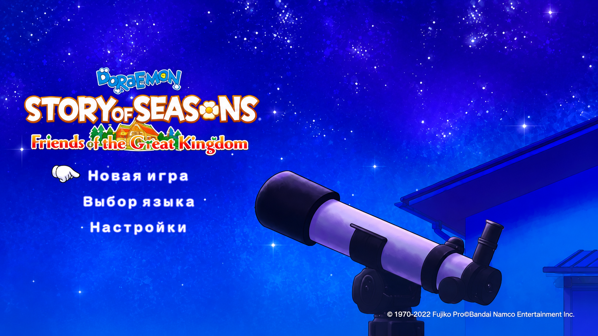
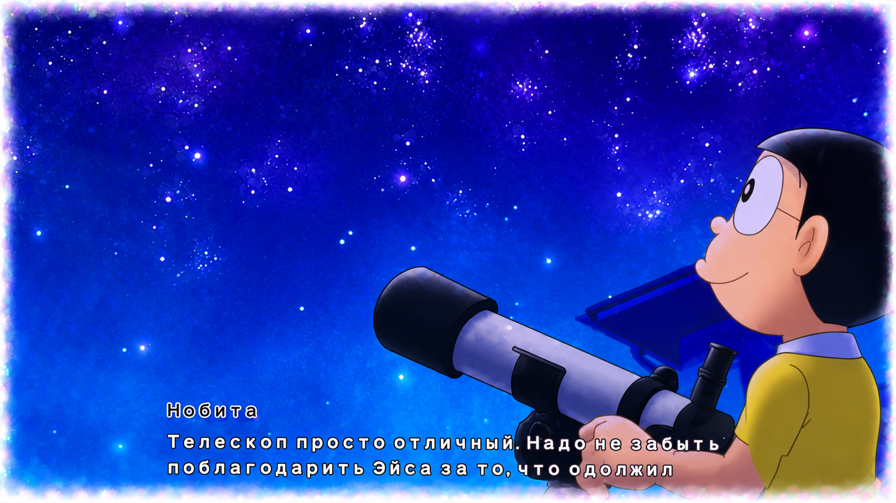
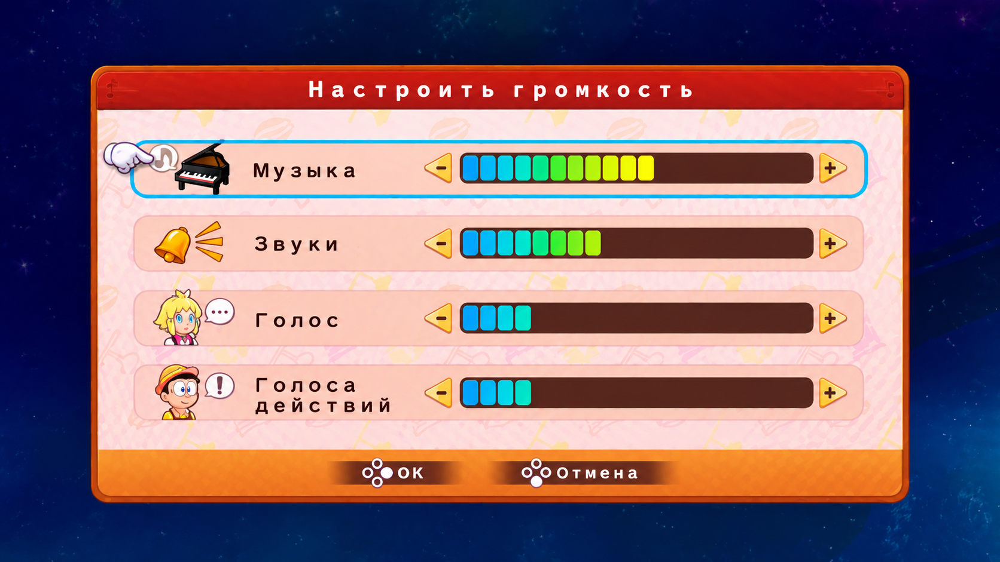
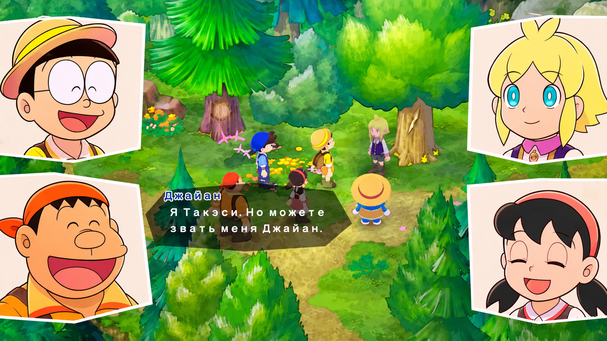
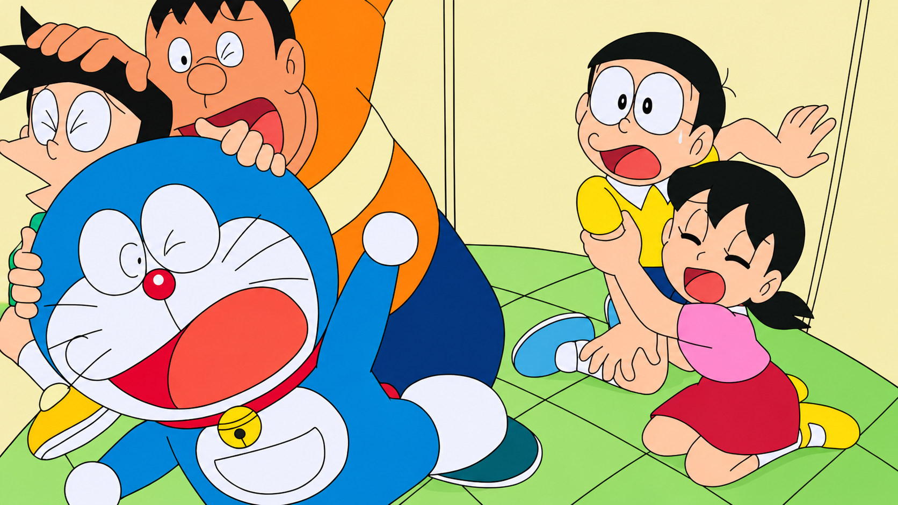

# 🌸 Sakura Doraemon FGK RU

### Полная русская локализация DORAEMON STORY OF SEASONS: Friends of the Great Kingdom для Nintendo Switch

**Версия перевода:** v1.3.0  
**Версия игры:** v1.3.0  
**Title ID:** `01009B50139A8000`

---

## 🌸 О проекте

**Sakura Doraemon FGK RU** — неофициальная фанатская русская локализация  
**DORAEMON STORY OF SEASONS: Friends of the Great Kingdom** для Nintendo Switch.

Перевод выполнен с адаптацией текста на естественный русский язык.

При работе над локализацией особое внимание уделялось:

- смыслу оригинальных реплик;
- характеру персонажей;
- эмоциональной окраске диалогов;
- юмору;
- естественности русского текста;
- единой терминологии;
- именам персонажей и названиям игровых объектов;
- корректному отображению текста непосредственно в игре.

Цель проекта — не дословный перевод английских фраз, а ощущение полноценной
русской локализации игры.

---

## 📊 Объём локализации

Обработано и локализовано **27 761 текстовая запись**.

В перевод вошли:

- диалоги персонажей;
- сюжетные сцены;
- интерфейс;
- предметы и описания;
- задания;
- обучение;
- системные сообщения;
- названия и игровая терминология.

Перевод проверен непосредственно на Nintendo Switch.

В отдельных местах длинные русские фразы могут выходить за исходные границы
текстовых блоков из-за фиксированной вёрстки игры. Это не мешает прохождению.

---

## 🎮 Совместимость

Игра:

**DORAEMON STORY OF SEASONS: Friends of the Great Kingdom**

Версия:

**v1.3.0**

Title ID:

`01009B50139A8000`

Для работы русификатора требуется установленная оригинальная игра.

**Игра в состав проекта не входит.**

---

## 📸 Скриншоты

### Русская локализация в игре

---

## 📦 Установка

Скачайте архив:

`Sakura-Doraemon-FGK-RU-v1.3.0.zip`

Распакуйте его и скопируйте папку:

`atmosphere`

в корень SD-карты Nintendo Switch с объединением существующих папок.

Файлы локализации должны оказаться по адресу:

`atmosphere/contents/01009B50139A8000/romfs/`

После установки полностью закройте игру и запустите её снова.

---

## 🗑 Удаление

Для удаления локализации удалите каталог:

`atmosphere/contents/01009B50139A8000`

Если в этом каталоге установлены другие модификации игры, не удаляйте его
целиком — удалите только файлы Sakura Doraemon FGK RU.

---

## 🔐 Контрольные суммы

Релиз `Sakura-Doraemon-FGK-RU-v1.3.0.zip`:

`SHA-256: b26860c692ac74aed242dbf3acd936df357b1b3813ad1af8d9447dfb0f988340`

---

## ⚠️ Важно

Это неофициальный фанатский проект.

Оригинальная игра не распространяется вместе с русификатором и должна быть
получена пользователем отдельно.

Проект не связан с Nintendo, Marvelous, Bandai Namco Entertainment,
Fujiko Pro или другими правообладателями DORAEMON STORY OF SEASONS:
Friends of the Great Kingdom.

Все названия, товарные знаки и материалы оригинальной игры принадлежат
соответствующим правообладателям.

---

## 🌸 Sakura

Проект создан из любви к игре и желанию сделать её доступной
русскоязычным игрокам.

**Sakura цветёт! 🌸**
